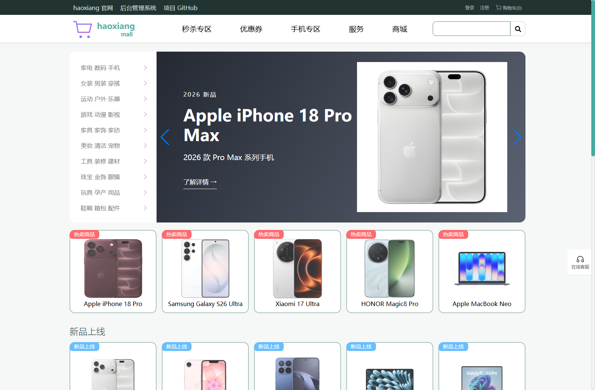
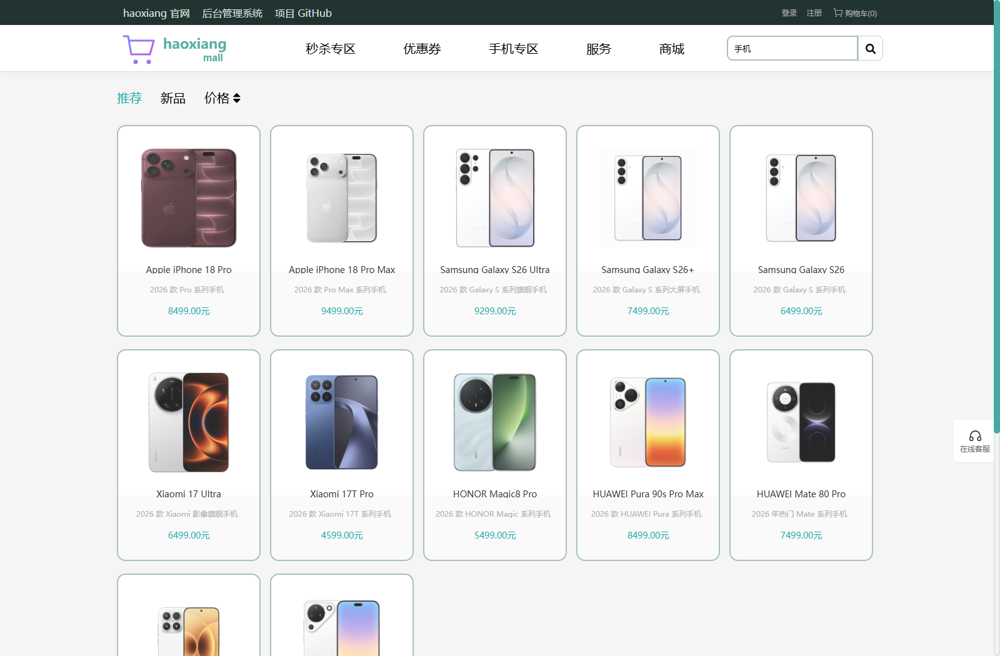
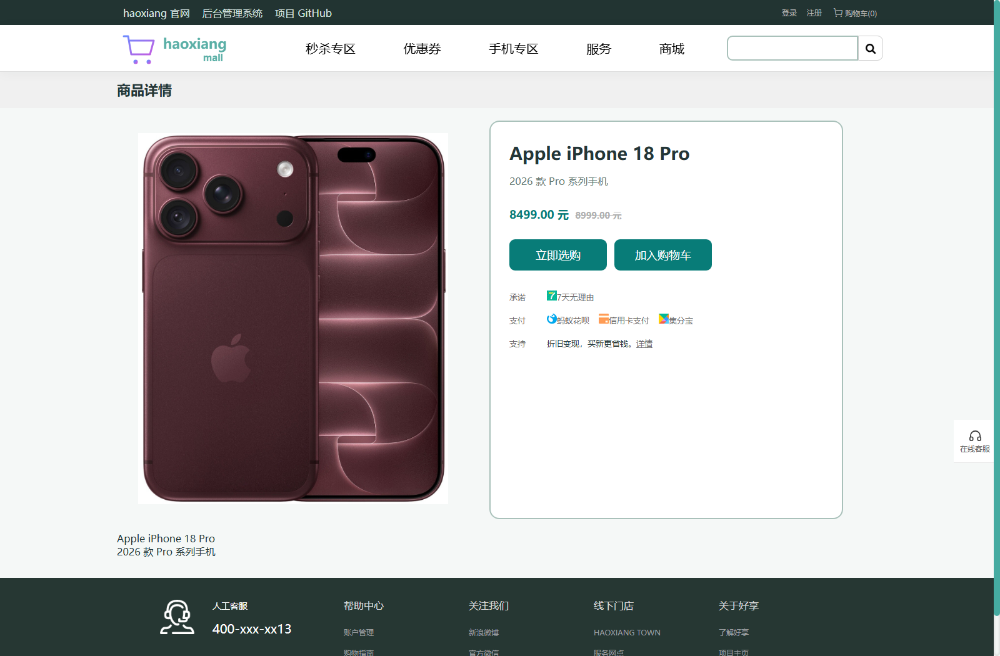
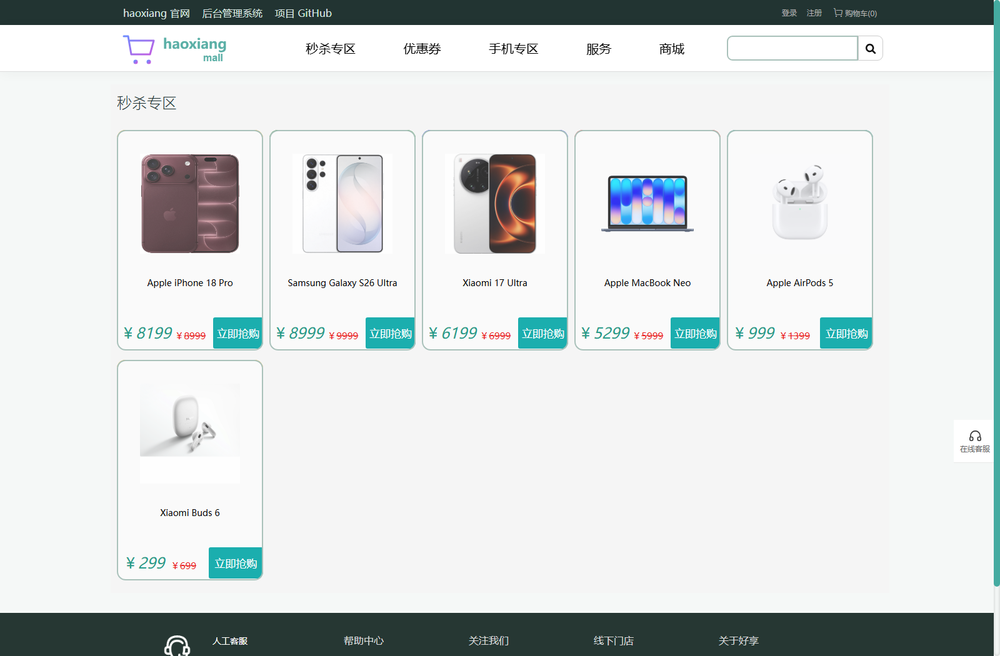
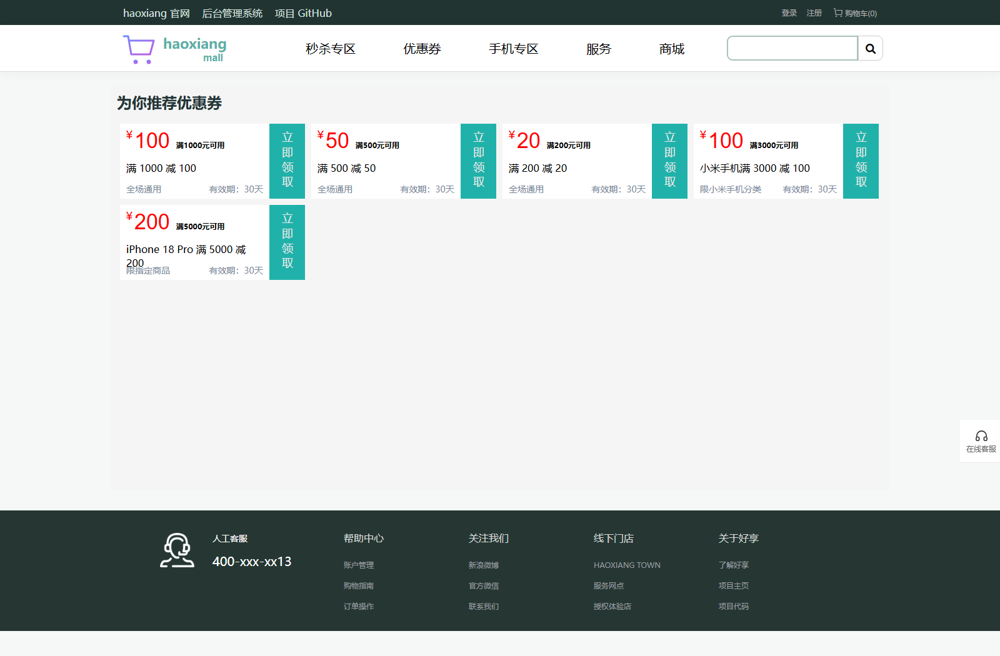
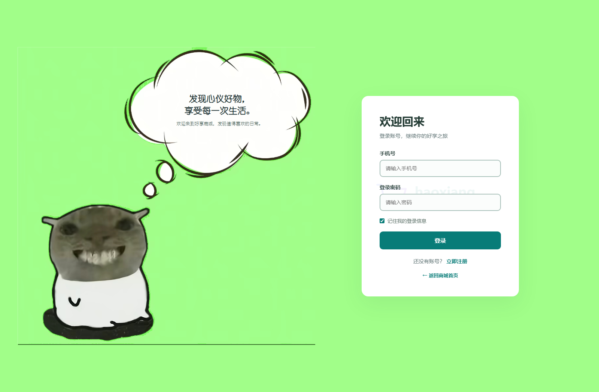
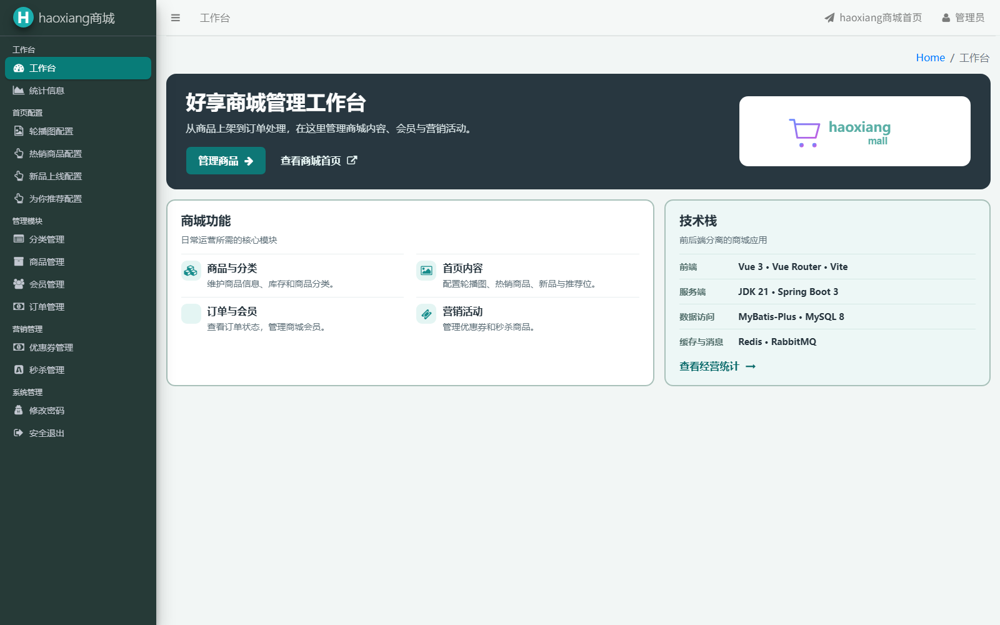
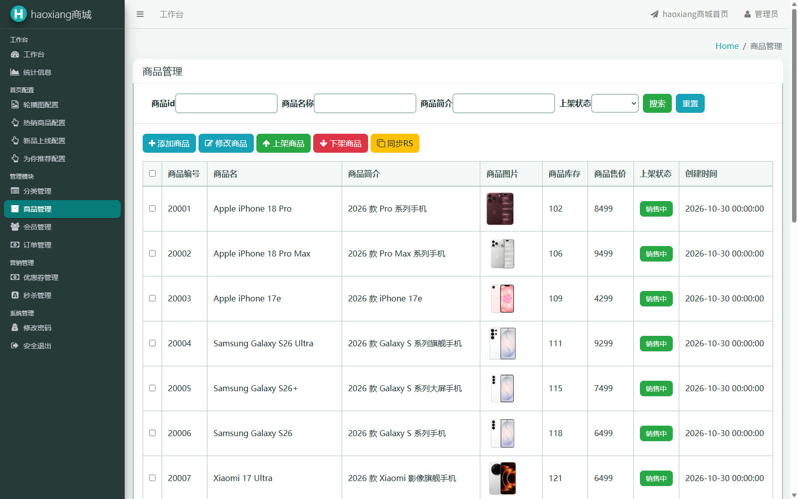
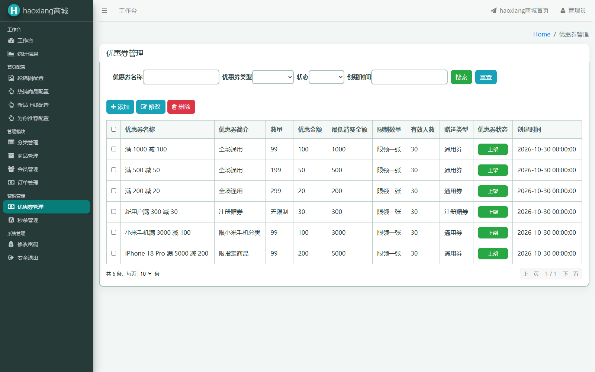

<div align="center">
  

  # haoxiang mall

  **发现心仪好物，享受每一次生活。**

  一个包含商城前台与运营管理后台的电商项目。围绕商品、订单和营销业务，探索缓存、并发库存与异步处理。

  
  
  
  
  
  

  [功能预览](#功能预览) · [业务功能](#业务功能) · [技术栈](#技术栈) · [快速开始](#快速开始) · [项目结构](#项目结构)


---

## 功能预览

> 以下为本地运行截图，商品名称、图片和价格仅用于界面演示。

### 商城首页



### 发现与选购

<table>
  <tr><td align="center"><strong>商品搜索与排序</strong></td><td align="center"><strong>商品详情</strong></td></tr>
  <tr><td></td><td></td></tr>
  <tr><td align="center"><strong>秒杀专区</strong></td><td align="center"><strong>优惠券中心</strong></td></tr>
  <tr><td></td><td></td></tr>
  <tr><td align="center"><strong>会员登录</strong></td><td align="center"><strong>运营工作台</strong></td></tr>
  <tr><td></td><td></td></tr>
  <tr><td align="center"><strong>商品管理</strong></td><td align="center"><strong>优惠券管理</strong></td></tr>
  <tr><td></td><td></td></tr>
</table>

## 业务功能

| 商城前台 | 运营管理 |
| --- | --- |
| 注册、登录、滑块验证码、个人信息 | 管理员登录、经营统计 |
| 首页轮播、分类、商品推荐 | 轮播图与首页推荐位配置 |
| 商品搜索、价格排序、商品详情 | 分类、商品、会员管理 |
| 购物车、订单结算、订单查询 | 订单处理、商品上下架 |
| 优惠券领取与使用、秒杀专区 | 优惠券与秒杀活动管理 |

支付页面通过校验用户登录密码模拟支付状态变更，**没有接入真实支付渠道或资金划转**。

## 技术栈

| 分类 | 技术 | 用途 |
| --- | --- | --- |
| 服务端 | JDK 21、Spring Boot 3.5.16 | 业务服务与 Web 接口 |
| 持久层 | MyBatis-Plus 3.5.18、MySQL 8.0 | 数据访问、分页与业务数据存储 |
| 缓存与会话 | Redis Stack、Spring Session Redis、Lettuce、Jedis | 数据缓存、共享会话、商品搜索与秒杀相关状态 |
| 异步处理 | RabbitMQ、Spring AMQP | 秒杀订单消息投递与异步消费 |
| 并发控制 | Redis Lua、Guava | 秒杀库存预扣与请求限流 |
| 前端 | Vue 3、Vue Router、Vite 7 | 商城和管理端页面 |
| 部署 | Docker Compose、Nginx | 本地多服务启动、静态资源与请求代理 |

## 核心链路

- **用户会话：** 登录状态由 Spring Session 存入 Redis，拦截器根据会话校验用户身份。
- **商品检索：** 支持 Redis Search 索引查询及 MySQL 查询回退，支持关键字和价格排序。
- **商品详情缓存：** 使用短期空值缓存、按商品互斥重建、随机 TTL 与失效代次，降低重复回源与集中到期的影响。
- **秒杀下单：** 资格检查后，在订单提交阶段使用 Redis Lua 预扣，再通过 RabbitMQ 异步处理订单；数据库通过库存条件更新约束扣减。
- **订单关闭：** 当前项目使用 `DelayQueue` 触发未支付订单超时处理，相关取消与补偿流程仍在持续完善。

## 快速开始

需要 Docker Desktop

创建 `.env.infra.local`，填写下列变量并替换为自己的本地密码：

```dotenv
HAOXIANG_DB_ROOT_PASSWORD=replace_with_mysql_root_password
HAOXIANG_DB_USER=haoxiang
HAOXIANG_DB_PASSWORD=replace_with_mysql_password
HAOXIANG_REDIS_PASSWORD=replace_with_redis_password
HAOXIANG_RABBIT_USER=haoxiang
HAOXIANG_RABBIT_PASSWORD=replace_with_rabbitmq_password
```

### 2. 启动基础服务

```powershell
docker compose --env-file .env.infra.local -f compose.infra.yml up -d mysql redis rabbitmq
```

MySQL **首次创建空数据卷**时会自动运行 `backend/sql/haoxiang_mall_schema.sql`，创建数据库和表；此文件不包含演示账号和商品。等待 MySQL 启动完成后，可以检查：

```powershell
docker compose --env-file .env.infra.local -f compose.infra.yml exec mysql sh -c 'mysqladmin ping -uroot -p"$MYSQL_ROOT_PASSWORD" --silent'
```

### 3. 可选：导入本地演示数据

如需与截图类似的体验，可在**新建且未导入业务数据的数据库**中执行完整测试 SQL。该文件使用固定 ID，不能重复导入到已有业务数据库。

```powershell
docker compose --env-file .env.infra.local -f compose.infra.yml cp backend/sql/haoxiang_mall_local_test.sql mysql:/tmp/haoxiang-demo.sql
docker compose --env-file .env.infra.local -f compose.infra.yml exec -T mysql sh -c 'exec mysql -uroot -p"$MYSQL_ROOT_PASSWORD" --default-character-set=utf8mb4 < /tmp/haoxiang-demo.sql'
```

演示数据的后台账号为 `admin`，密码为 `123456`，仅供本地测试。导入后可在后台商品管理中使用“同步 RS”构建 Redis Search 商品索引。

### 4. 构建并启动应用

```powershell
docker compose --env-file .env.infra.local -f compose.infra.yml up -d --build
docker compose --env-file .env.infra.local -f compose.infra.yml ps
```

| 服务 | 本机地址 |
| --- | --- |
| 商城 | [http://127.0.0.1:8080/](http://127.0.0.1:8080/) |
| 管理后台 | [http://127.0.0.1:8080/admin](http://127.0.0.1:8080/admin) |
| 后端 | `127.0.0.1:8081` |
| MySQL | `127.0.0.1:23306` |
| Redis Stack | `127.0.0.1:16379` |
| RabbitMQ / 管理界面 | `127.0.0.1:5672` / [http://127.0.0.1:15672/](http://127.0.0.1:15672/) |

Compose 中前端也绑定本机 `80` 端口；启动前请确认上述端口未被占用。首次构建需要拉取镜像和下载依赖，时间取决于网络。数据和上传文件保存在 Docker 命名卷中。

```powershell
# 查看后端日志
docker compose --env-file .env.infra.local -f compose.infra.yml logs -f backend

# 停止容器并保留数据卷
docker compose --env-file .env.infra.local -f compose.infra.yml down
```

## 本地开发

- 后端使用 JDK 21 与 Maven，`backend/src/main/resources/application-dev.yml` 从环境变量读取 MySQL、Redis、RabbitMQ 连接参数；`.env.infra.local` 不会被 Spring Boot 自动加载到本机进程，需在 IDE 运行配置或终端中设置。
- 如果基础服务运行在 Compose，宿主机运行后端时使用上表的宿主机端口；后端容器内部使用 `mysql`、`redis`、`rabbitmq` 服务名。
- 前端需要 Node.js 20.19+ 或 22.12+；在 `frontend/` 运行 `npm ci` 和 `npm run dev`。开发代理默认指向 `127.0.0.1:8081`，可通过 `frontend/.env.local` 配置 `VITE_LEGACY_TARGET`。
- 开发代理的 `/legacy` 是当前前端访问后端接口的代理前缀，不需要启动其他后端项目。

## 项目结构

```text
haoxiang/
├── backend/
│   ├── src/main/java/com/haoxiang/mall/  # 控制器、业务服务、Mapper、缓存与消息
│   ├── src/main/resources/mapper/        # MyBatis XML
│   └── sql/                              # 建表与本地演示数据
├── frontend/
│   ├── src/                              # Vue 页面、组件、路由与接口
│   └── public/                           # 图片与静态资源
├── assets/readme/                        # 项目功能截图
├── compose.infra.yml                     # 本地完整服务编排
└── LICENSE
```

## 许可与致谢

项目使用 [GPL-3.0](LICENSE) 许可，部分代码和界面资源基于 [newbee-mall-pro](https://github.com/wayn111/newbee-mall-pro)，感谢原作者及相关开源项目。
